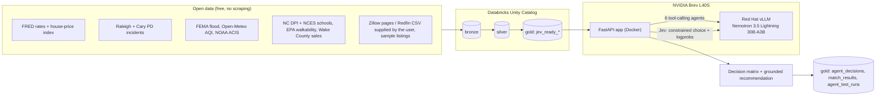

# EstatePulse AI: six Nemotron tool-calling agents that find a buyer's home

**NVIDIA × Red Hat Small Models Hack · Raleigh, 17–18 Oct 2026 · Track 3: Tool-Calling**
Also entered for the bounties: Best Use of NVIDIA Nemotron Lightning · Best Model Improvement With NVIDIA NeMo Gym · Best Use of Red Hat vLLM

| | |
|---|---|
| **Live app** | **https://dreamhome-sfdndu5im.gobrev.dev** |
| Hackathon page | https://concrete-panther-c83.notion.site/nv-rh-small-models-hack |
| Demo video | [add the unlisted YouTube/Vimeo link] |
| Architecture slide | [add the slide link] |

### Judge logins (demo accounts with synthetic data only)

Choose the account type on the sign-in page, then use:

| Sign in as | Email | Password | What you'll see |
|---|---|---|---|
| **Admin (tester)**: start here | `admin@estatepulse.demo` | `Judge-Admin-7584dd` | Everything: **Find a home** (the 6 agents live), **Data flow**, **Agent test lab**, **Architecture**, and the realtor and client views |
| Realtor workspace | `realtor@estatepulse.demo` | `Judge-Realtor-79b586` | The realtor's 12-step workspace, client intakes, and the decision matrix |
| Client | `client@estatepulse.demo` | `Judge-Client-6bd300` | A buyer's portal with their questionnaire and matched homes |

**A 3-minute tour:**
1. Sign in as Admin and open **Find a home**. Type "3 bed 2 bath under $500k in Raleigh, commute to downtown Raleigh under 25 minutes" and watch the 6 agents call their tools, then Jev's verdicts, then the ranked homes.
2. Open **Data flow**. Click any agent to see which Databricks gold tables it reads, then press **Run the 6 agents** to trace a live run.
3. Open **Agent test lab**. Pick an agent, edit its prompt and run it. NeMo Gym scores every run, and the leaderboard compares prompt versions.
4. Try "4 bedroom house under $150k in Durham". Instead of inventing a home, it asks whether you'd like to raise the budget to the cheapest real match.

---

## For the judges: start here

**What it is:** six Nemotron agents running on vLLM, each calling one tool, turn a home buyer's request into ranked homes. Jev, our decision layer, makes a calibrated tour / consider / skip call on each home. All the data is free and public, governed in Databricks Unity Catalog, and every agent is tested with NeMo Gym.

**How we meet each challenge** (all numbers are from live runs on 18 Oct 2026):

| Challenge | How we answer it | Proof | Where to look |
|---|---|---|---|
| Small model (≤33B) doing real tool calling | Nemotron 3.5 Lightning 30B-A3B (about 3B active parameters) on vLLM. Six agents, each owning one tool; the five scoring agents run in parallel. | All 15 scoring-agent runs finished on Nemotron. The listing agent passed the buyer's filters to its search tool exactly in 4 of 4 test cases. | `app/agents.py`, `app/metric_agents.py`, `/testlab` |
| Turning plain English into exact tool arguments | A rule-based parser and a forced Nemotron tool call are merged. Numbers come from the parser, and a value from the model is kept only if it appears in the buyer's own words. | The shipped extractor got 12 of 12 test requests exactly right; Nemotron alone got 9 of 12. The check also caught the model inventing a location ("Durham" from "near Duke") and a bedroom count (3 from "family of four"). | `app/extract.py`, `scripts/agent_eval.py` |
| No made-up homes, and graceful empty results | Every home is checked against the must-haves, whatever arguments the model sent. With zero matches the app says "Would you like to raise the budget to about $X?", where X is computed from real listings. A write-up that names an address not in the results is replaced. | 3 of 3 impossible requests returned no homes plus a useful suggestion. A simulated write-up that invented "742 Evergreen Terrace" was caught. | `tests/test_agent_quality.py` |
| Calculation errors | Python computes every number: payments, ratios, discounts, forecasts and the 10 scores. The agents and Jev only judge. Jev reads one constrained answer and its token probabilities, so its confidence is calibrated. | Scores computed from Databricks gold equal scores computed locally (maximum difference 0 across every home and all 10 criteria), and Jev agrees with the local results at least as well as with its own re-run. | `app/metrics.py`, `app/jev.py`, `scripts/architecture_validate.py` |
| Agent evaluation with NeMo Gym | A NeMo Gym environment with reward functions per agent, used for evaluation runs, reward-scored training samples, and the prompt test lab. See the next section. | Prompt changes found with the Gym reward took 4 of 5 scoring agents from 0–50% to 100% pass. | `resources_servers/estatepulse`, `/testlab` |
| Data governance | Databricks bronze → silver → gold layers in Unity Catalog, with tags, CHECK constraints, lineage, audit tables, three-role access control and a row filter on personal data. The live app reads gold. | 41 of 41 workspace data-quality checks pass, and gold matches the app's local data exactly. | `pipeline/databricks_sink.py`, `app/gold.py`, `/pipeline` |
| Reliability | Every outside service has a fallback, and a failure-injection demo shows the recovery. | 189 automated tests run in CI and inside the Docker image, plus the live evaluation and validation scripts. | `tests/`, `.github/workflows/` |

**Honest gaps.**
- **Commute** uses estimated drive times until an `ORS_API_KEY` is added; the free key is pending.
- **Durham and Chapel Hill** have no live police feed, so they use a fixed default safety rating.
- **The Safety & Environment agent** passes 50% in the test lab; see below.
- **No fine-tuning:** we did not train model weights. The RL samples are collected and ready for a training run.

> Build history and earlier designs (where you see 10 or 14 agents) are in [docs/BUILD_LOG.md](docs/BUILD_LOG.md). The shipped crew is the six agents above.

## Bounties: what each asks for and how we meet it

The hackathon page lists the bounty names; we read each one as its title describes.

### Best Use of NVIDIA Nemotron Lightning
**Requirement:** make Nemotron Lightning central to a working system.
**How we meet it:**
- **One model for everything.** NVIDIA Nemotron 3.5 Lightning 30B-A3B is the only generative model in EstatePulse. It runs all of these:
  - the 6 tool-calling agents;
  - the plain-English filter extraction (a forced `set_search_filters` tool call);
  - Jev's per-home decisions;
  - the final recommendation.
- **Why Lightning.** It is a mixture-of-experts model with 30B total but only about 3B active parameters. That gives 30B-class tool calling at small-model speed on one L40S: about 1–1.4 s per scoring-agent call, and about 2–3 s for the listing agent's search.
- **Evidence:**
  - all 15 scoring-agent runs finished on Nemotron;
  - the listing agent passed the buyer's filters exactly in 4 of 4 test cases;
  - plain-English extraction is 12/12 exact as shipped;
  - all of it is live in `/app`, `/pipeline` and `/testlab`.

### Best Model Improvement With NVIDIA NeMo Gym
**Requirement:** use NeMo Gym to measurably improve the model's results.
**How we meet it:**
- **The environment.** `resources_servers/estatepulse` is a NeMo Gym resources server. `rewards.py` scores each agent: half for calling its tool with every home, half for picking the right best home. Deal and Forecast are graded against the computed answer.
- **Round 1, the baseline evaluation** (`results/gym/`): the two tasks that asked the model to output a number scored lowest: Forecast passed 63% and Deal 79%, against 88–100% for the rest. We responded by **moving all arithmetic out of the model**: Python computes every number Jev weighs.
- **Round 2, plain-English filters to tool arguments:** 75% exact with Nemotron alone, **100%** as shipped.
- **Round 3, the prompt test lab** (`/testlab`, graded by the same Gym `eval_reward`): **4 of 5 scoring agents went from 0–50% to 100% pass** after one prompt change found by the reward.
- **Honest scope:** we improved the system around the model (prompts, tools, guardrails, data), and NeMo Gym measured every step. The 96 reward-scored samples are ready for a GRPO fine-tuning run. The full write-up is in [How NeMo Gym made the agents better](#how-nemo-gym-made-the-agents-better).

### Best Use of Red Hat vLLM
**Requirement:** make vLLM central to the system, not just a model host.
**How we meet it:** Nemotron is served by vLLM 0.31 on our own Brev GPU (`start_nemotron.sh`), so no client data leaves the machine. We use more than plain text generation:

| vLLM feature | What it gives us |
|---|---|
| Tool calling (`--enable-auto-tool-choice --tool-call-parser qwen3_coder`) | All 6 agents call tools natively |
| Forced tool choice + structured outputs | Filter extraction always returns valid arguments; Jev answers with exactly one option letter |
| **Logprobs** | Jev turns the probabilities of its option letters into a calibrated tour / consider / skip confidence, in a single token |
| Continuous batching (`--max-num-seqs 32`) + prefix caching | The 5 scoring agents and Jev's per-home calls run in parallel on one GPU |
| FP8 quantization + Nemotron reasoning parser | The 30B model fits a 48 GB L40S with room for the batch |

Because vLLM exposes an OpenAI-compatible API, the app, NeMo Gym and the eval scripts all talk to the same server.

### NVIDIA Developer Champions Choice Award
**Our pitch:** a complete, governed system that a realtor could use tomorrow, built in 24 hours on NVIDIA Brev with Nemotron, vLLM and NeMo Gym. It covers the buyer questionnaire, 6 agents, Jev decisions, a Databricks medallion, a judge-facing data-flow view and a prompt test lab. Every claim in this README is backed by a test or a live-run number.

## How NeMo Gym made the agents better

NeMo Gym is our referee. `resources_servers/estatepulse` is a NeMo Gym resources server, and `rewards.py` holds the reward functions:
- **Scoring agents:** half the reward for calling the agent's tool with every shortlisted home, half for naming the same best home as the deterministic math.
- **Deal and Forecast:** graded against the computed answer.

We used it in three rounds. Each round changed the system, not the model's weights.

**1. Baseline on 17 Oct, earlier 10-agent design** (`results/gym/`). There were 8 evaluation sets of 8 tasks each, plus 48 reward-scored samples each for the Deal and Forecast tasks:

| Agent | Mean reward | Pass rate |
|---|---|---|
| Commute, Environment, Lifestyle, Maintenance, Rooms | 1.00 | 100% |
| Safety, School, Urban | 0.94 | 88% |
| Deal (pick the best deal) | 0.88 | 79% |
| Forecast (state a 12-month % as a number) | 0.96 | **63%** |

The two tasks that asked the model to produce a number scored lowest. That confirmed the rule the shipped system follows: **the model never does arithmetic.** Python computes the payments, the discount against the neighborhood price per sq ft, and the forecast. The agents and Jev receive those numbers as facts and only judge. This is what keeps calculation errors out of Jev's decisions: every input Jev weighs (monthly payment, housing ratio, % above or below the area price, commute minutes, safety index) is computed and validated before Jev sees it.

**2. Plain-English filters to tool arguments** (`scripts/agent_eval.py`), on 12 labelled requests:

| Extractor | Exact match | Precision | Recall |
|---|---|---|---|
| Nemotron alone | 75% | 0.89 | 0.98 |
| Shipped (rules + Nemotron, grounded in the buyer's words) | **100%** | **1.00** | **1.00** |

**3. Prompt test lab** (`/testlab`): the same Gym `eval_reward`, run on the six-agent crew over 4 fixed buyers on live Nemotron. Every run is stored in `gold.agent_test_runs`.

| Agent | Current prompt (pass rate) | + "finish with `ANSWER: <listing_id>`" |
|---|---|---|
| Zillow Listing | 100% | — |
| Commute & Location | 0% | **100%** |
| Budget & Investment | 50% | **100%** |
| Lifestyle & Amenities | 0% | **100%** |
| Property Condition | 25% | **100%** |
| Safety & Environment | 0% | 50% (open finding: it weighs safety over environment on 2 buyers) |

Every agent already called its tool on every home. They lost points only because they never stated a single, checkable answer. The Gym reward made that visible within a minute, and one sentence in each prompt fixed it.

**How this helps Jev decide.** Jev's verdicts are only as good as the evidence it receives. NeMo Gym checks three things before that evidence reaches the decision matrix:
- each agent sees every home;
- each agent's pick agrees with the computed scores;
- no number was produced by the model.

Our validation then confirms that Jev reads the same values from Databricks gold as the app computed locally.

---

## Architecture



**One model, six tool-calling roles, all on one vLLM server.** The Zillow Listing Agent calls `find_listings`. Each of the five scoring agents (Safety & Environment, Commute, Budget & Investment, Lifestyle & Amenities, Property Condition) calls its own `get_<agent>_evidence` tool, and the five run in parallel. Python computes every number. Jev, our decision layer, asks the same Nemotron one constrained question per home and reads the token probabilities, which gives a calibrated tour / consider / skip verdict. A 10-criterion matrix, weighted by the buyer's own priorities, then ranks the homes.

**Model and rules.** NVIDIA Nemotron 3.5 Lightning 30B-A3B (30B total parameters, about 3B active), served by vLLM with FP8 quantization (`start_nemotron.sh`). It is the only generative model in the system, so the total is 30B, within the ≤33B limit.

| Layer | Technology |
|---|---|
| Model serving | vLLM 0.31: OpenAI-compatible API, tool-call parser, structured outputs, logprobs, prefix caching |
| Agents | Python, FastAPI, OpenAI SDK, against the local vLLM server |
| Data | Databricks Free Edition: Unity Catalog medallion layers via the SQL Statement API; tags, CHECK constraints, row filter |
| Evaluation | NeMo Gym resources server (`resources_servers/estatepulse`), eval harnesses + reward-scored samples, plus the `/testlab` prompt lab |
| Infrastructure | NVIDIA Brev L40S, Docker, GitHub Actions CI (189 tests) |

## Quick start

```bash
git clone https://github.com/nez6/RedHat_NVIDIA_Hack && cd RedHat_NVIDIA_Hack
python3 -m venv env && env/bin/pip install -r requirements.txt -r requirements-dev.txt vllm

# 1. the model: Nemotron on vLLM, port 8000, served as "nemotron" (first run downloads the weights)
./start_nemotron.sh

# 2. settings: copy the sample and fill in what you have (only the three passwords are needed for a demo)
cp .env.example ~/.estatepulse.env && nano ~/.estatepulse.env

# 3. the app: build and run on port 8501
docker build -t estatepulse-app:latest . && scripts/restart_app.sh latest
open http://localhost:8501

# optional: publish the data to Databricks, then validate the whole architecture
docker exec estatepulse python -m pipeline.databricks_sink
python scripts/architecture_validate.py
python scripts/agent_eval.py               # live accuracy eval against Nemotron
env/bin/python -m pytest -q                # 189 tests, no GPU or network needed
```

**Reproducing the demo.** `.env.example` lists every setting with a comment. All of them are optional except the three demo passwords:
- **Without Databricks:** the app reads its local snapshot in `data/live/`.
- **Without the free API keys:** the affected feature degrades gracefully. For example, commute uses a distance estimate until `ORS_API_KEY` is set, and new-city lookups use defaults without `CENSUS_API_KEY` / `FBI_API_KEY`.

## Data sources and provenance

**The full list of all 25 ingestion pieces** (endpoint, key, code file, the Databricks table it lands in, which agent uses it, and how to refresh it): **[docs/DATA_INGESTION.md](docs/DATA_INGESTION.md)**.

| Data | Source | How it is used |
|---|---|---|
| Mortgage rates, FHFA house-price index, unemployment | FRED (St. Louis Fed), keyless CSV, 10 years | Budget & Investment agent; `gold.jev_ready_macro` |
| 90-day police incidents (FBI NIBRS categories) | Raleigh PD and Cary PD open-data portals | Safety index per neighborhood |
| Flood zones, 30-day air quality, heat and heavy-rain days | FEMA NFHL, Open-Meteo, NOAA ACIS | Environment index |
| School proficiency, school locations | NC DPI 2025–26 assessments, NCES EDGE | School rating (nearest elementary, middle and high school) |
| Walkability | EPA National Walkability Index | Urban and walk score |
| Sales price per sq ft, year built, assessed value | Wake County parcels (ArcGIS) | Deal score and listing enrichment |
| Any other US city (live lookup) | OpenStreetMap Nominatim, Census geocoder / TIGERweb / ACS, Education Data API, FBI Crime Data Explorer | Neighborhood profiles for cities outside the Triangle |
| Listings | Zillow pages and Redfin "Download All" CSVs saved by the user (we parse files; we never scrape), RentCast free API, and **61 synthetic sample listings** (`data/listings.csv`, made by `data/make_data.py`) | Candidate homes |
| Evaluation sets | Generated from the deterministic scorers by `resources_servers/estatepulse/build_datasets.py`, plus 12 hand-labelled requests in `tests/fixtures/extraction_cases.json` | NeMo Gym and agent evals |

## Known limitations and next steps

**Limitations**
- **Commute:** drive times are estimated until a free OpenRouteService key is added.
- **Safety coverage:** Durham and Chapel Hill have no live police feed, so they use a fixed default rating.
- **Safety agent pick:** the Safety & Environment agent passes 50% in the test lab, because on 2 buyers it weighs safety over environment.
- **Answer line not live yet:** adding the `ANSWER:` line to the prompts was validated in the test lab but is not yet the default.
- **Listings:** most demo listings are synthetic; real ones come from pages the user saves, or RentCast's free tier (50 requests a month).
- **No fine-tuning:** we improved prompts, tools, guardrails and data, not model weights. The NeMo Gym reward-scored samples are ready for a GRPO run.

**Next steps**
- **Switch on the improved prompts** and fix the Safety agent's weighting.
- **Fine-tune** with the collected NeMo Gym samples for the Deal and Forecast tasks.
- **Wider coverage:** a licensed MLS / listing API once there is revenue, and Durham-area police data.

## Team

| Name | Role | Contact |
|---|---|---|
| Natalie Zachariah | Solo Builder | nez6@duke.edu |

---

Build history, design notes and every subsystem in depth: **[docs/BUILD_LOG.md](docs/BUILD_LOG.md)**.
